<div align="center">

# 👋 Hey, I'm Munayam Rahman

### 🎓 CST Student | 🐍 Python Developer in Progress | 🤖 Aspiring ML Engineer


<br/>


<a href="https://github.com/munayamrahman121-bilp?tab=followers">

</a>

</div>

---

## 👨‍💻 About Me

```python
class Developer:

    def __init__(self):
        self.name = "Munayam Rahman"
        self.role = "CST Diploma Student"
        self.language = "Python"
        self.current_focus = "Machine Learning"
        self.goal = "Machine Learning Engineer"

    def introduce(self):
        print("Learning today, building tomorrow!")

me = Developer()
me.introduce()
```

- 🎓 Diploma Student in **Computer Science & Technology (CST)**
- 🐍 Currently learning **Python Programming**
- 🤖 Aspiring **Machine Learning Engineer**
- 🧠 Interested in Artificial Intelligence & Data Science
- 🚀 Building projects and improving my coding skills
- 🌱 Learning something new every day

---

## 🛠️ Tech Stack & Tools

<div align="center">


</div>

---


## 📊 GitHub Overview

<div align="center">

<a href="https://github.com/munayamrahman121-blip">

</a>


<br/><br/>

### 💻 My Developer Journey

| Focus Area | Current Status |
|---|---|
| Python | 🌱 Learning |
| Machine Learning | 🎯 Future Goal |
| Artificial Intelligence | 🔍 Exploring |
| Data Science | 📚 Upcoming |

<br/>

**Building my skills, one project at a time.**

</div>

## 🐍 Contribution Snake Animation


<div align="center">



</div>

## 🎯 My 2026 Goals

- [ ] Master Python Programming
- [ ] Learn NumPy and Pandas
- [ ] Understand Mathematics for Machine Learning
- [ ] Learn Data Science Fundamentals
- [ ] Start Machine Learning Projects
- [ ] Build Real-World AI Applications
- [ ] Become a Professional ML Engineer

---

## 📌 Featured Projects

<div align="center">

<a href="https://github.com/munayamrahman121-bilp?tab=repositories">

</a>

</div>

---

## 🤝 Connect With Me

<div align="center">

<a href="https://github.com/munayamrahman121-bilp">

</a>

</div>

---

<div align="center">

### 💡 "Dream Big. Learn Consistently. Build Fearlessly."

**Thanks for visiting my profile! ⭐**


</div>

